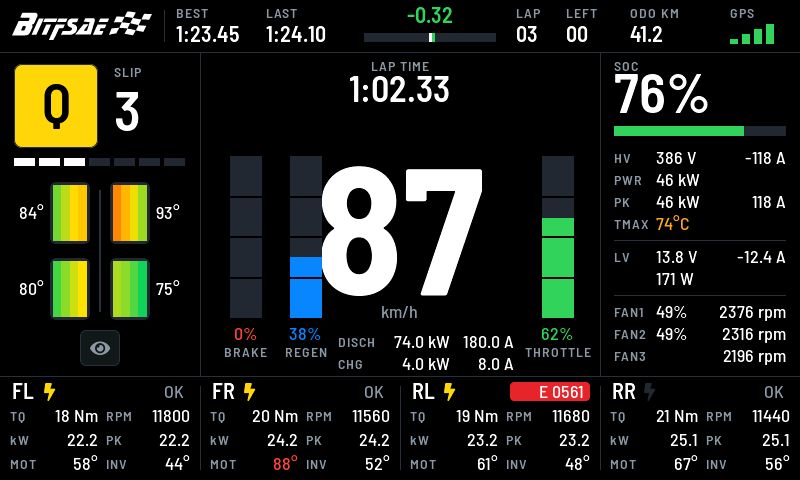
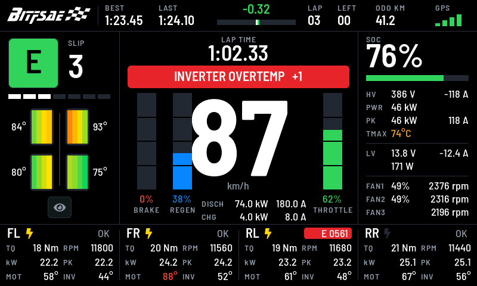
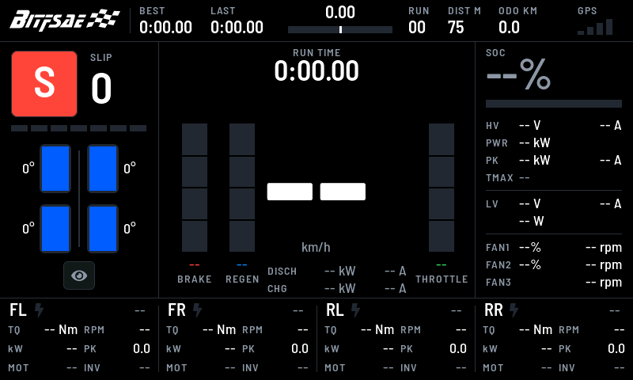

# 仪表盘界面

目标为 SSD1963 驱动的 800×480 IPS 屏，由 STM32F407ZET6 经 FSMC 局部刷新（RGB565，800×10 行缓冲）。





## 代码结构

| 文件 | 职责 |
| --- | --- |
| `stm32_port/Core/Src/dashboard_view.c/.h` | 纯 LVGL 视图：布局、样式、绘制、触摸区域判定。不含 HAL/RTOS 调用 |
| `stm32_port/Core/Src/dashboard_ui.c` | 控制器：各任务/中断提交数据的缓冲与脏标记、圈速/冲刺控制、告警队列、背光 PWM |
| `stm32_port/Core/Src/fonts/dash_font_*.c` | 由 `tools/gen_dash_fonts.sh` 生成的字库，勿手改 |
| `stm32_port/Core/Src/dash_logo.c` | 由 `tools/gen_dash_logo.sh` 从 `tools/assets/BITFSAE.svg` 生成的 A8 标识，勿手改 |
| `src/freertos_main.c` | 模拟器：编译同一份视图，以动画演示数据驱动 |

`Dash_View_*` 只能在 LVGL 线程（Dashboard 任务）调用；`Dash_View_HitTest` 是纯函数，触摸任务可直接调用。轮序沿用 `dashboard_data_t`：0=FL、1=RL、2=FR、3=RR。

## 布局

| 区域 | 坐标 (px) | 内容 |
| --- | --- | --- |
| 顶栏 | y 0–52 | BITFSAE 标识、BEST、LAST、圈差（数值+条）、LAP/RUN、LEFT/DIST M、ODO KM、GPS 信号 |
| 左栏 | x 0–200 | 驾驶模式色块（S 红/Q 黄/C 蓝/E 绿，可触摸轮转）、SLIP 等级与 7 段条、四轮胎面温度图与最高温、夜间按钮 |
| 中栏 | x 200–600 | 当前圈/冲刺用时与计时状态点、告警/READY 横幅、180 px 车速、机械制动/能量回收/油门三条竖条、车速下方的 SOP（DISCH/CHG 两行：BMS 允许的放电/充电功率与电流） |
| 右栏 | x 600–800 | SOC 与电量条、HV 电压/电流、PWR 实时功率、PK（功率峰值与放电电流峰值）、TMAX、LV 电压/电流/功率、三路风扇；行距 22 px |
| 底栏 | y 376–480 | FL/FR/RL/RR 电机：使能（闪电黄=使能）、故障码（红底 `E xxxx`，十进制，不足四位补零）、TQ (Nm)/RPM、功率 kW 与 PK（功率峰值）、MOT/INV 温度 |

触摸区域：顶栏开始/停止计时（S 模式为 75 m 冲刺）；驾驶模式色块按 S→Q→C→E→S 轮转一档；告警横幅消除最早一条；夜间按钮把背光降到 45%。模式色块点击通过 CANB 发送既有 `0x310` 请求（byte0 为 ASCII `0`..`3`，DLC 8），界面在入队成功后立即显示新模式，ECU 的 `0x509` 回报会再校正显示。圈速/冲刺计时进行中模式被锁定，点击不发送、不换档，并提示 `MODE LOCK: TIMER ACTIVE`。方向盘的圈速计时键与触摸顶栏等效，消错键清除全部告警，见 [方向盘与车手屏](steering_wheel.md)。告警文字转大写，`+N` 表示还有 N 条排队。



无效数据：车速在上电后到首条可信 RMC 之前、GNSS 数据超过新鲜度门限或状态为 V 时显示 `--`（真实的 0 km/h 显示 `0`，见 [GPS 与圈速](gps_lap.md)）；右栏、中栏踏板和底栏电机的 CAN 数值在上电后、源帧超时或自报无效时显示 `--`（灰色），踏板条清空，电机功率在扭矩或转速无效时为 `--`。能量回收条在编码器超时或尚未找到静止零点时显示 `--`，不会用 0% 冒充未知状态。各 setter 以 `DASH_VIEW_INVALID` 表示某个参数无效，电机列用 `dash_motor_t.invalid` 位；模拟器不使用这些值。有效位的来源、超时和各报文的取舍见 [CAN 接口](can_interface.md)。

PWR 为放电功率 −V×I（BMS 电流充电为正、放电为负），充电和回收显示 0。

**PK 的含义**：界面上标 PK 的值都是**上电以来出现过的最大值**，不清零，掉电才复位。松油门、扭矩为 0 或回收都不会清掉它们。TMAX 不是峰值，它是此刻最热的一处。

- 右栏 PK 行：左侧为整车放电功率峰值（电功率 −V×I，kW），右侧为放电电流峰值（整安培，取 −I 截断，与 HV 行一致），充电和回收不计。两项随 `0x4B0` 更新；上电后尚未收到有效电压电流时显示 `--`。
- 底栏每个电机的 PK：单电机轴功率峰值（T×n/9549，kW）。

右栏 PK 取自 `0x4B0`，BMS 每 500 ms 发一帧，两帧之间的瞬时尖峰看不到，它不是电流传感器的真实瞬时最大值，更高频的数据见遥测记录。底栏电机 PK 取自 ECU 的扭矩和转速帧。

SOP 来自 BMS 的 `0x4A0`（功率，kW）和 `0x4A3`（电流，A），接收规则和超时见 [CAN 接口](can_interface.md)。DISCH 为允许放电、CHG 为允许充电/回收；功率和电流各自判断新鲜度，无效时显示 `--`；DISCH 的功率或电流为 0（BMS 禁止动力）时红色。

中栏的机械制动条（红）由 `0x305` 油压换算，能量回收条（蓝）由 `0x001` 踏板转角减去在线静止零点后换算，油门条（绿）仍来自 `0x305`。机械制动与能量回收是两个独立开度，不相加；各自的失效状态和超时见 [CAN 接口](can_interface.md)，参数见 [配置表](configuration.md)。

颜色规则：MOT、INV、TMAX ≥70 °C 琥珀、≥85 °C 红（`TEMP_WARN_C`/`TEMP_HOT_C`）；SOC <50 % 琥珀、<20 % 红；圈差变快为绿色向右、变慢为红色向左，±5 s 满格。扭矩原始值即 Nm（DBC 单位文字误写为 0.1 %Mn），电机功率 = T×n/9549，显示 0.1 kW。

## 性能约束

- 纯黑底、实色填充；不用渐变、阴影、透明度。圆角只用于静态元素。
- 样式共享（`lv_style_t`），避免每个对象的局部样式分配；数值标签固定宽度，文字变化只重绘该框。
- 三条踏板条、电量、圈差、滑移、信号、胎温均为单对象 + 绘制回调，不叠子对象。
- setter 缓存输入，文字和颜色不变时不触发重绘；控制器另有 50/200 ms 分级节流；车速不节流，GNSS 的 20 Hz 每次变化都立即应用。固件的 LVGL 刷新周期为 16 ms（`main.c`，模拟器仍为 33 ms），新车速最多等一个周期上屏。
- 字库：Barlow Semi Condensed（OFL，`tools/fonts/`），4 bpp 不压缩，按需裁剪字符集；图标取 LVGL 自带 FontAwesome。固件已关闭 Montserrat，默认字体为 `dash_font_s`。

改版后（对比 `5860890`）：Flash 254,144 B（+27 KB：速度字库约 22 KB，标识 4 KB），主 SRAM 不变；主机 64 位回归测得 LVGL 池峰值 55.2 KB（原 61.6 KB）。目标机余量以 `g_firmware_diag.lvgl_*` 为准。

加入 SOP 与 PK 行后（对比 `dff4403`）：Flash +1,076 B，主 SRAM +96 B，CCM 不变；主机回归池峰值 54,864 → 57,576 B。目标机指针为 32 位，预计低于主机值，余量未上板实测。

## 标识

`tools/assets/BITFSAE.svg` 离线栅格化为 140×29 的 A8 透明度图（4,060 B Flash），由绘制回调 `lv_draw_image` 以白色着色。A8 在 LVGL 软件渲染中直接以 Flash 数据为遮罩混合，不经解码缓冲，不占 RAM，也无需开启 `LV_USE_IMAGE` 控件；只在顶栏重绘时参与绘制。SVG 运行时渲染需 ThorVG（C++、数十 KB Flash 与较大内存），不采用。更换标识或尺寸：替换 SVG 后运行 `tools/gen_dash_logo.sh [高度]`，必要时调整 `create_top()` 中各块的 x 坐标。

## 验证

```bash
python3 tools/run_firmware_tests.py --png /tmp/dash   # 编译固件 UI 与 LVGL，跑回归并输出七帧截图（四种模式、告警、READY、无数据）
./build_fw.sh                                         # ARM 构建与内存报告
./run_sim_mac.sh                                      # 模拟器
./tools/gen_dash_fonts.sh                             # 改字号/字符集后重新生成字库（需 Node.js）
./tools/gen_dash_logo.sh                              # 重新生成标识位图（需 Node.js）
```
